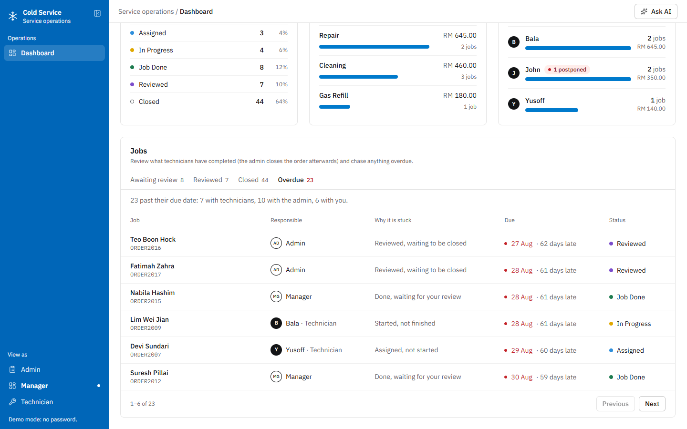
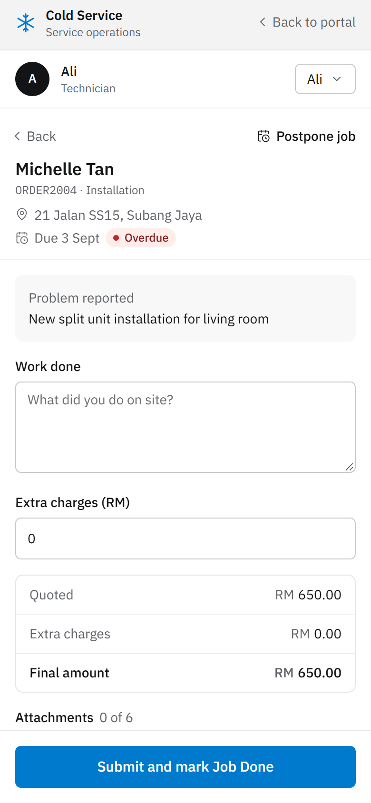
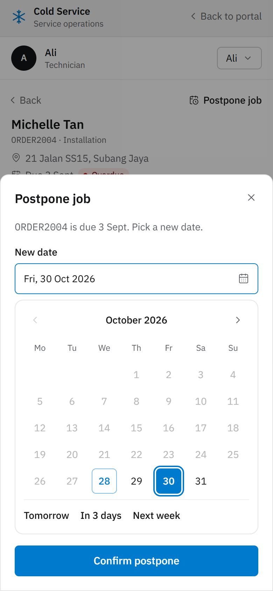
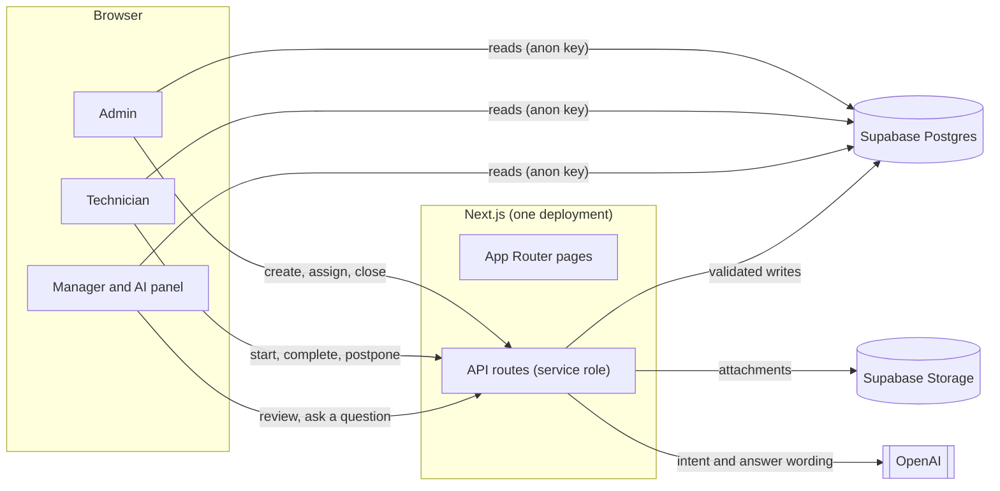

# Cold Service

Operations software for an aircon servicing company. The office takes and assigns
service orders, technicians run their jobs from a phone, and the manager reviews
finished work and watches the numbers, with an AI assistant that answers questions
about the data and about how to use the system.

**Live demo:** https://coldservice.vercel.app


**Built with:** Next.js 16 (App Router) · React 19 · TypeScript · Supabase (Postgres + Storage) · Tailwind CSS v4 · OpenAI

---

## Contents

- [Features](#features)
- [Screenshots](#screenshots)
- [Getting started](#getting-started)
- [How it works](#how-it-works)
- [AI assistant](#ai-assistant)
- [Project structure](#project-structure)
- [Design](#design)
- [Limitations and roadmap](#limitations-and-roadmap)

## Features

**Admin** (desktop)
- Create orders: customer, phone, address, problem, service type, quoted price, due date, and an optional technician. Order numbers (`ORDER2001`, `ORDER2002`, …) are generated by the database.
- One list of every order with tabs ordered by what needs attention: **New · Overdue · Assigned · In Progress · Job Done · Reviewed · All**, live counts, and search by customer, order number, address or phone.
- Four at-a-glance numbers (need a technician, overdue, in progress, reviewed) that double as shortcuts to their tabs.
- Assign a technician from the row, open any order for the full detail, and **close** orders the manager has reviewed.

**Technician** (mobile-first)
- A job list scoped to the signed-in technician, with address, problem, due date and an overdue marker.
- Start a job, then complete it with work done, extra charges (the final amount is calculated, never typed), remarks and up to 6 photo, video or PDF attachments.
- Postpone a job to a new date with a calendar picker (Tomorrow, In 3 days and Next week shortcuts).
- A pre-filled WhatsApp message to the customer when a job is done.

**Manager** (desktop)
- Weekly, monthly or yearly view: jobs completed, revenue, postponements, and how many jobs are waiting for review.
- Charts for revenue and jobs completed over time, every order by stage, revenue by service type, and a technician ranking.
- A review queue (**Awaiting review → Reviewed**) and an **Overdue** tab that names who is responsible for each stuck order: the technician while the job is with them, the manager once it is done and waiting for review, the admin when nobody is assigned or when it is reviewed but not yet closed.

**Everywhere**
- An AI assistant (Manager screen) for questions about completed jobs, postponements and overdue orders, plus "how do I…" help.
- A full audit trail: every status change is written to `status_history`.
- Runs as an empty template when Supabase is not configured (see [Getting started](#running-without-supabase)).

## Screenshots

**Admin: orders**


**Admin: new order**


**Manager: overdue tasks and who is responsible**



**Manager: AI assistant**


**Technician (mobile)**

<table>
  <tr>
    <td></td>
    <td></td>
    <td></td>
  </tr>
  <tr>
    <td align="center">My jobs</td>
    <td align="center">Complete a job</td>
    <td align="center">Postpone a job</td>
  </tr>
</table>

**Role select**


The screenshots use sample data.

## Getting started

### Prerequisites

- Node.js 20.9 or newer
- A [Supabase](https://supabase.com) project (free tier is fine)
- An [OpenAI](https://platform.openai.com) API key (optional, for the AI assistant)

### Install and run

```bash
git clone https://github.com/wudiclann/cold_service.git
cd cold_service
npm install
cp .env.example .env.local   # then fill in the values below
npm run dev
```

Open http://localhost:3000.

### Environment variables

| Variable | Required | Where to find it |
| --- | --- | --- |
| `NEXT_PUBLIC_SUPABASE_URL` | Yes | Supabase → Project Settings → API |
| `NEXT_PUBLIC_SUPABASE_ANON_KEY` | Yes | Supabase → Project Settings → API (the public key) |
| `SUPABASE_SERVICE_ROLE_KEY` | Yes | Supabase → Project Settings → API (the secret key, server only) |
| `OPENAI_API_KEY` | No | OpenAI dashboard. Without it the AI panel shows a message instead of an answer. |

`.env.local` is git-ignored. Never put the service-role key in a `NEXT_PUBLIC_` variable, because those are sent to the browser.

### Database

The app expects these in your Supabase project (the schema is not yet included as migrations):

| Item | Purpose |
| --- | --- |
| `technicians` | `id`, `name`. The people who can be assigned to jobs. |
| `orders` | One row per job: `order_no`, customer details, `service_type`, `quoted_price`, `assigned_technician_id`, `status`, `due_date`, timestamps. |
| `service_logs` | What the technician recorded on completion: `work_done`, `extra_charges`, `final_amount`, `remarks`, `technician_name`, `completed_at`, `attachments[]`. |
| `postponements` | Each time a job's due date was pushed back, and to when. |
| `status_history` | Every status change: from, to, who (role) and when. |
| `ai_rate_limits` | Request log used to rate-limit the AI assistant. |
| `generate_order_no()` | A database function returning the next `ORDERnnnn` number. |
| `attachments` | A Supabase Storage bucket (public) for job photos and files. |

### Running without Supabase

If the Supabase keys are missing, the app still starts. Every screen opens as an empty template (no orders, zeros on the dashboard, empty charts) with a notice explaining what to add. Anything that would save data fails with a clear message instead of crashing. Add the keys and restart the dev server and the notice disappears.

### Scripts

| Command | What it does |
| --- | --- |
| `npm run dev` | Start the development server |
| `npm run build` | Create a production build |
| `npm start` | Serve the production build |
| `npm run lint` | Run ESLint |

### Deploying

The project deploys as a single Next.js app, for example on [Vercel](https://vercel.com). Add the four environment variables in the project settings.

## How it works

### Roles

There is no real login. The first screen is a role picker (Admin, Technician, Manager) that stores the choice in the browser, and technicians also pick their name from the technician list. Each role gets its own screen, and the sidebar's **View as** switch moves between them. This is a demo stand-in for authentication, not a security boundary.

### Order lifecycle

```
New → Assigned → In Progress → Job Done → Reviewed → Closed
```

| Step | Done by |
| --- | --- |
| Create the order, assign a technician | Admin |
| Start the job, complete it, or postpone it | Technician |
| Mark a finished job as reviewed | Manager |
| Close a reviewed order | Admin |

The allowed transitions live in one place, `lib/orderTransitions.ts`, and every API route checks them before writing, so a request cannot skip a step. Each change also writes a `status_history` row.

### Architecture



- **Reads** (order lists, job list, dashboard) go straight from the browser to Supabase with the public key.
- **Anything that must not be trusted from the client** (status changes, the audit trail, `final_amount`, file uploads) goes through an API route that uses the service-role key and re-validates the request. Row-level security is enabled with permissive policies, so the API routes are the real trust boundary.
- **Uploads** are proxied through `POST /api/orders/[id]/complete` so the completion record and its attachments are written in one request.

## AI assistant

Open it from **Ask AI** on the Manager screen. The model never touches the database. Each question goes through three separate steps:

1. **Understand** (`lib/ai/intent.ts`): the model only classifies the question into a fixed shape (`metric`, `date_range`, `technician_name`) using structured output. It cannot write SQL.
2. **Look up** (`lib/ai/query.ts`): that classification selects one of a few hand-written queries. The model cannot widen or redirect it.
3. **Answer** (`lib/ai/respond.ts`): a second call receives only the rows that were fetched (or, for "how do I…" questions, a written reference in `lib/ai/systemKnowledge.ts`) and turns them into a sentence.

**What it can answer:** completed jobs (overall, per technician, per period), postponements, overdue orders, and how to use the system. Anything else is refused with a fixed message rather than guessed.

**Safeguards:** 10 questions per 10 minutes per IP, a 500-character limit on questions, and a fixed model (`gpt-4o-mini`). Set a spending limit on the OpenAI project as a final backstop.

## Project structure

```
app/
  page.tsx                 role picker
  (app)/                   Admin and Manager shell (sidebar, top bar)
    admin/page.tsx         orders
    manager/page.tsx       dashboard
  technician/page.tsx      technician screens
  api/
    orders/                create an order; [id]/ assign, start, complete, postpone, review, close
    kpi/technician-summary dashboard numbers (week, month, year)
    ai/query               the AI assistant
components/
  ui/                      buttons, inputs, select, date picker, tabs, table, dialog, charts, ...
  shell/Brand.tsx          logo and name
  AskAiWidget.tsx          AI side panel
  SetupNotice.tsx          "Supabase isn't set up" banner
lib/
  supabase/                browser client, server (service-role) client, empty-template stand-in
  ai/                      intent, query, response, rate limit, system knowledge
  orderTransitions.ts      the order lifecycle rules
  types.ts                 shared types and service types
docs/screenshots/          images used in this README
```

## Design

- **Layout:** a full-height blue sidebar (collapsible, remembered between visits) beside a white page. On phones the sidebar becomes a slide-in menu, and the Technician screens are laid out for one hand.
- **Colour:** neutral greys with one blue accent (`#007ACC`). Colour is kept for actions, data and status: statuses are a coloured dot beside plain text, and overdue is a small red dot with a red date.
- **Type:** IBM Plex Sans, with IBM Plex Mono for order numbers.
- **Charts and inputs** are drawn with plain HTML and CSS (no chart library). The dropdowns and the calendar are custom components so they match the rest of the interface and work from the keyboard.

## Limitations and roadmap

- **No real authentication.** The role picker is a demo stand-in, so the API routes are not tied to a signed-in user.
- **WhatsApp** opens a pre-filled `wa.me` link. It does not send through the WhatsApp Business API.
- **The `payments` table** exists in the schema but is not used by the app.
- **No automated tests yet.**
- **The AI assistant is read-only** and single-turn: it answers questions but cannot act, and it only remembers the last few messages.
- **Rate limiting is per IP**, which is easy to get around without real accounts.
- **Schema migrations** are not in the repository yet.
