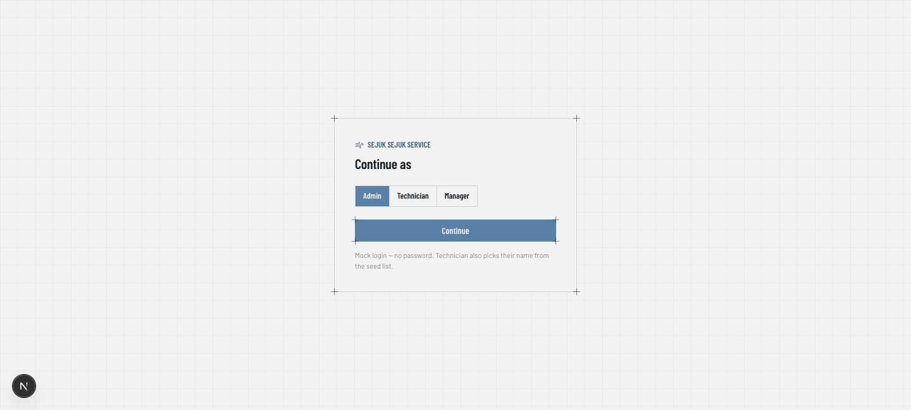
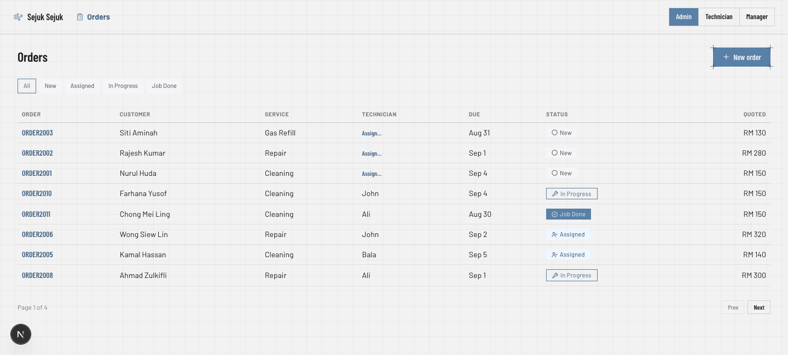
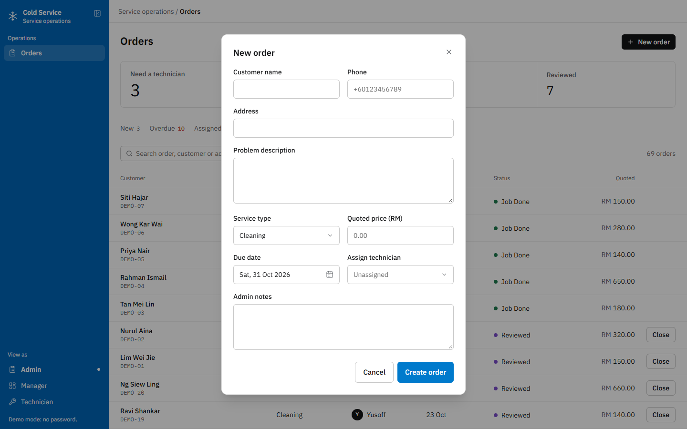
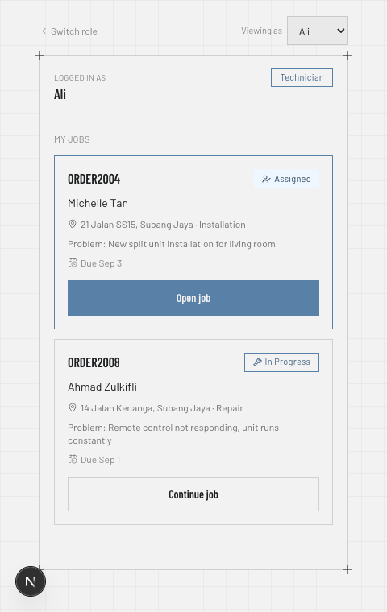
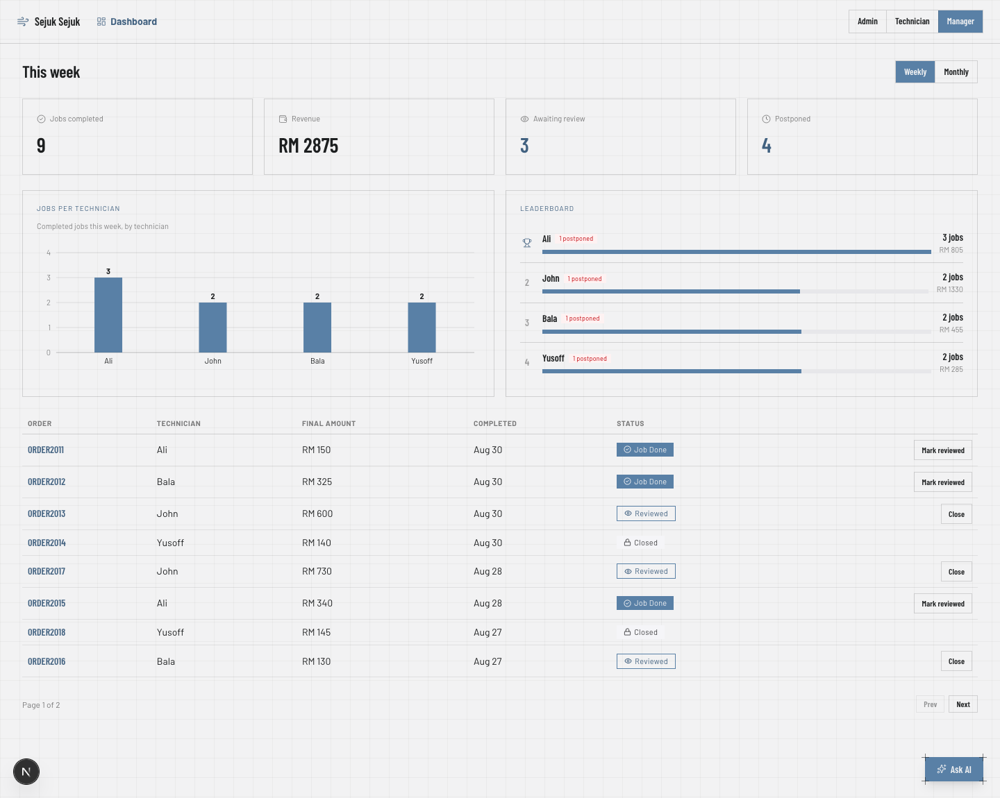
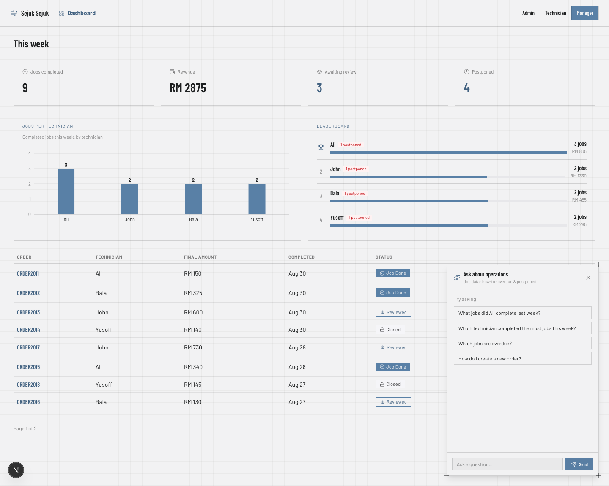
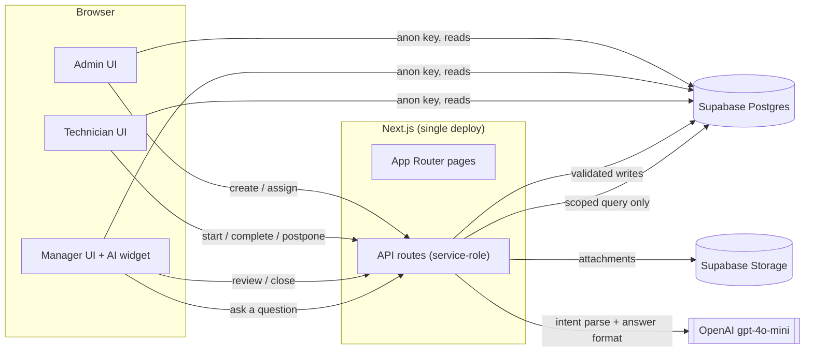

# Sejuk Sejuk Ops

Operations system for a (fictional) aircon service company. Admin creates and
assigns service orders, technicians run jobs from the field on mobile, and
managers review completed work and track KPIs — with an AI assistant that can
answer questions about the operational data or how to use the system.

Built for the "Operations System + AI Challenge" programmer assessment.

**Live demo:** https://servicesejuk.vercel.app
**Stack:** Next.js (App Router) · TypeScript · Supabase (Postgres + Storage) · Tailwind CSS v4 · OpenAI

---

## What you built

- **Admin Portal** — create orders, assign technicians, filter/paginate the
  order list, view full order detail, auto-generated order numbers
  (`ORDER2001`, `ORDER2002`, …), due dates with overdue flagging.
- **Technician Portal** — mobile-first job list scoped to the logged-in
  technician, job detail with postpone-to-a-new-date, job completion form
  (final price, work done, photo/file attachments via Supabase Storage), and
  a generated WhatsApp deep link to notify the customer on completion.
- **Manager Dashboard** — weekly KPI cards (jobs completed, revenue, awaiting
  review, postponed), a per-technician bar chart, a ranked leaderboard, and a
  job-review table to move completed jobs through `Reviewed → Closed`.
- **AI Operations Assistant** — a chat widget on the Manager dashboard that
  answers natural-language questions about completed jobs, postponements, and
  overdue orders, and separately answers "how do I…" questions about using
  the system itself. See [How AI was integrated](#how-ai-was-integrated)
  below.
- **Demo data** — 25 seeded orders spanning New/Assigned/In Progress/Job
  Done/Reviewed/Closed, across today/this week/last week, so pagination, the
  KPI dashboard, and the leaderboard all have something real to show.

## Screenshots

**Role select (mock login)**


**Admin — order list**


**Admin — new order**


**Technician — job list (mobile)**


**Manager — KPI dashboard**


**Manager — AI assistant**


## Tech stack

- **Frontend/Backend**: Next.js App Router — one deploy, API routes as the backend
- **Language**: TypeScript
- **Database**: Supabase (Postgres), with Supabase Storage for job attachments
- **Styling**: Tailwind CSS v4 (CSS-first `@theme`, no config file), on a
  custom "Industry" design system — steel-blue accent, Barlow/Barlow
  Condensed type, square-cornered "blueprint" components with corner
  registration marks
- **Charts**: Recharts
- **Icons**: Lucide
- **AI**: OpenAI `gpt-4o-mini`
- **Auth**: none — mock role switcher only (see below), per the assessment's
  scope

## System architecture



**Mock auth, no real login.** A role switcher (Admin / Technician / Manager)
on the landing page sets the active role in a React context
(`lib/role-context.tsx`), persisted to `localStorage`. Technicians
additionally pick their name from the seeded list. There's no password and no
session — this satisfies the assessment's "mock role-switching" requirement
without building real auth.

**Trust boundary lives in API routes, not RLS.** Supabase RLS is enabled with
permissive "allow all" policies on every table, so it doesn't enforce
anything by itself. Instead:

- Anywhere a value must not be trusted from the client — order status
  transitions, `status_history` writes, `service_logs.final_amount` — goes
  through a Next.js API route using the Supabase **service role** key
  (`lib/supabase/server.ts`). The route re-validates the transition
  server-side (`lib/orderTransitions.ts`) before writing, so tampering with
  client state can't skip a step in the order lifecycle or forge a status
  change or a price.
- Plain reads (order list, job list, KPI dashboard) go straight from client
  components to Supabase using the anon key (`lib/supabase/client.ts`) — no
  API route needed.

**Order state machine**: `New → Assigned → In Progress → Job Done → Reviewed → Closed`,
enforced by `VALID_TRANSITIONS` in `lib/orderTransitions.ts`. Every route that
mutates `orders.status` also inserts a `status_history` row in the same
request, giving a full audit trail without real auth.

**AI trust boundary — the LLM never touches the database.** Every question
goes through three steps, each independently auditable:

1. **Parse intent** (`lib/ai/intent.ts`) — the LLM only classifies the
   question into a fixed schema (`metric`, `date_range`, `technician_name`)
   using structured JSON-schema output. It cannot generate SQL or free-form
   queries.
2. **Run a scoped query** (`lib/ai/query.ts`) — the intent is mapped to one
   of a small, fixed set of hand-written Supabase queries, run with the
   service-role key. The LLM has no ability to widen or redirect this query.
3. **Format the answer** (`lib/ai/respond.ts`) — a second LLM call receives
   only the already-fetched, already-scoped rows (or, for how-to questions,
   a written knowledge base — never the live operational tables) and turns
   them into a sentence. It cannot fetch anything it wasn't handed.

**File uploads** are proxied through `POST /api/orders/[id]/complete` (as
`multipart/form-data`) rather than uploaded directly from the browser to
Supabase Storage, so the same service-role request that writes
`final_amount` and `service_logs` also handles the attachment — keeping job
completion atomic.

**Technician UI is a separate layout**, not a responsive breakpoint of the
Admin table view — one job card at a time, large tap targets, minimal fields
until needed. Admin and Manager share a top-nav shell since both are
desktop-oriented table/dashboard views.

## How AI was integrated

**What types of queries are supported:**

- Completed jobs — overall or filtered by technician and/or time range
  ("What jobs did Ali complete last week?", "How many jobs were completed
  today?")
- Postponements — which orders were postponed, by whom, how often
- Overdue orders — what's currently overdue
- "Help" / how-to questions about the system itself ("How do I create a new
  order?", "Where do I mark a job reviewed?", "Tell me about the system") —
  answered from a written reference (`lib/ai/systemKnowledge.ts`), completely
  separate from the operational database
- Anything outside those categories (revenue forecasting, freeform SQL,
  requests for the system prompt or API key, etc.) is classified
  `unsupported` and gets a safe, static fallback — never passed to a query or
  given a made-up answer

**Abuse protection**, since this uses a real, billed OpenAI API key and is
deployed publicly:

- Rate limiting — 10 requests / 10 minutes per IP, tracked in a Supabase
  table (`ai_rate_limits`) rather than a new external service, with
  opportunistic cleanup of expired rows
- Question length capped at 500 characters
- An OpenAI project-level spending cap as a last-resort backstop

**Limitations of the AI implementation:**

- Only the four metrics above are supported — anything else is refused
  rather than guessed
- No conversation memory beyond the last few turns passed in as context; it
  isn't a general-purpose chatbot
- Intent classification is LLM-based, so it's probabilistic, not
  deterministic — mitigated with explicit few-shot examples in the system
  prompt, but an unusual phrasing could still misclassify
- Rate limiting is per-IP, not per-authenticated-user, since there's no real
  auth — trivially bypassable by IP rotation, which is an acceptable
  trade-off at assessment scope, not for a real production deployment

## Challenges / assumptions

- **Recharts + React StrictMode in dev mode**: the KPI bar chart would
  occasionally mount with zero-height bars in `next dev`. Confirmed via a
  side-by-side production build (`next build && next start`) that this is a
  dev-only StrictMode double-mount artifact, not a real bug — it
  self-resolves on any re-render (e.g. a window resize).
- **Assumed mock role-switching was acceptable** in place of real auth, per
  the assessment's own "Authentication" section — no password, no session,
  just a role picker.
- **Postpone-date edge case**: the suggested new due date when postponing an
  already-overdue job could itself land in the past if computed naively from
  the old due date. Fixed by basing the suggested date on `max(old due date,
  today)`.
- **Proactively added AI abuse protection** (rate limiting, question length
  cap) that isn't explicitly required by the brief, on the assumption that a
  publicly deployed app with a live OpenAI key needs it regardless.

## What was deferred / out of scope

- Real authentication (mock role switcher only, per assessment scope)
- Real WhatsApp Business API integration — a `wa.me` deep link is generated
  instead (`lib/whatsapp.ts`)
- The `payments` table (schema exists, unused)
- The Optional Advanced AI Challenges (AI Workflow Supervisor, AI Document
  Understanding, AI Operational Insight) — not attempted
- Automated tests — verified manually end-to-end for each module instead

## Setup

```bash
npm install
```

Create `.env.local` with:

```
NEXT_PUBLIC_SUPABASE_URL=
NEXT_PUBLIC_SUPABASE_ANON_KEY=
SUPABASE_SERVICE_ROLE_KEY=
OPENAI_API_KEY=
```

Then:

```bash
npm run dev
```

## Self-assessment

**Which module was easiest?**
The Admin and Manager portals were the easiest to build. Both are
fundamentally CRUD-and-dashboard workflows — create an order, view/filter a
list, assign a technician, review a completed job — with a clear, linear
data flow and no unusual state to manage, so the implementation followed a
straightforward, predictable pattern.

**Which module was hardest?**
The WhatsApp notification module was the most complex to do properly — a
real implementation needs the Meta WhatsApp Business API and ideally a
native mobile app rather than a web deep link, which is a significant scope
on its own. With the whole system due in three days, I made a deliberate
call to scope this down to a `wa.me` deep link and put the time into getting
the core order lifecycle (Admin → Technician → Manager) and the AI module
solid instead, rather than spreading effort thin across every module.

**What would you improve in a real production system?**
I'd invest in the AI module the most. Right now it's a single-turn,
read-only assistant — it classifies a question, runs one scoped query, and
formats an answer. In a real production system I'd add a memory layer so it
can hold context across a longer conversation, and an agentic layer where
it's given a small set of bound tools (e.g. create an order, assign a
technician, mark a job reviewed) so it can act on a request rather than only
answer questions about the data — with the same scoped, server-validated
trust boundary the read path already has.

**How did you use AI tools while building this project?**
I started by defining the requirements and deciding on the architecture and
tech stack, then used Claude Design to design and iterate on the frontend
before touching any code. From there, Claude Code handled implementation
module by module — Admin, Technician, Manager/KPI, then the AI assistant —
and after each module I reviewed and tested the actual behavior against the
requirement to check Claude Code's reasoning and output stayed aligned with
what was asked, rather than accepting a module as done just because it ran.

## Acceptance criteria

- [x] Admin can create an order and see it appear in the order list with an
      auto-generated order number
- [x] Assigning a technician updates status to `Assigned`
- [x] Technician (filtered to their own name) can see their assigned job and
      submit a completion form with file upload
- [x] Final amount is computed server-side, not trusted from client input
- [x] Order status updates to `Job Done` on completion, and a WhatsApp deep
      link with the correct pre-filled message is generated
- [x] Manager can view completed jobs and move them to `Reviewed`/`Closed`
- [x] Every status transition is recorded in `status_history`
- [x] KPI dashboard shows jobs completed and total amount per technician for
      the current week
- [x] AI assistant answers operational questions and how-to questions, with
      rate limiting and a scoped-query trust boundary
- [x] README documents what was built, architecture, AI integration,
      challenges/assumptions, and limitations
